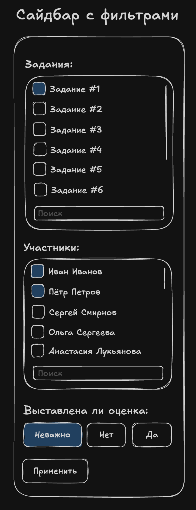
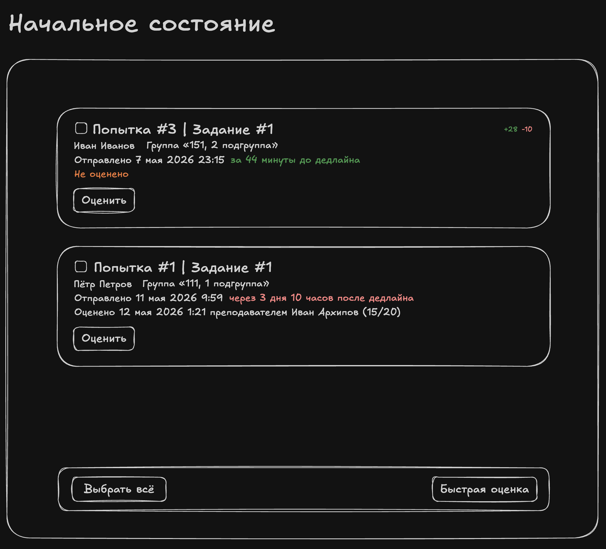
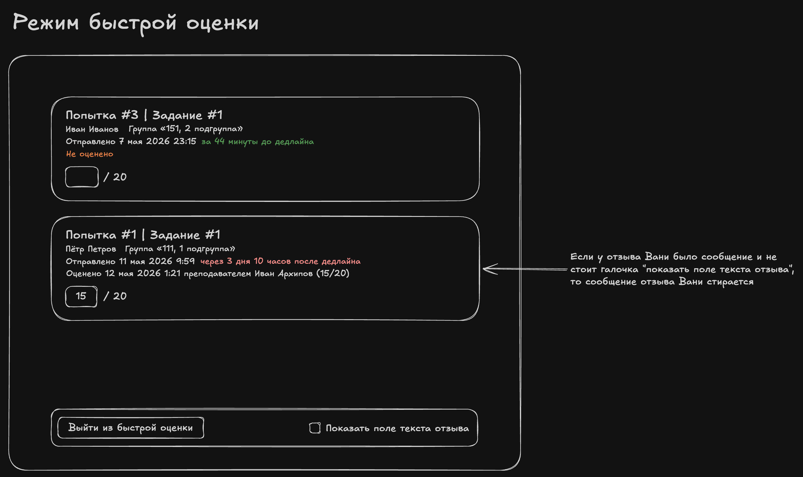
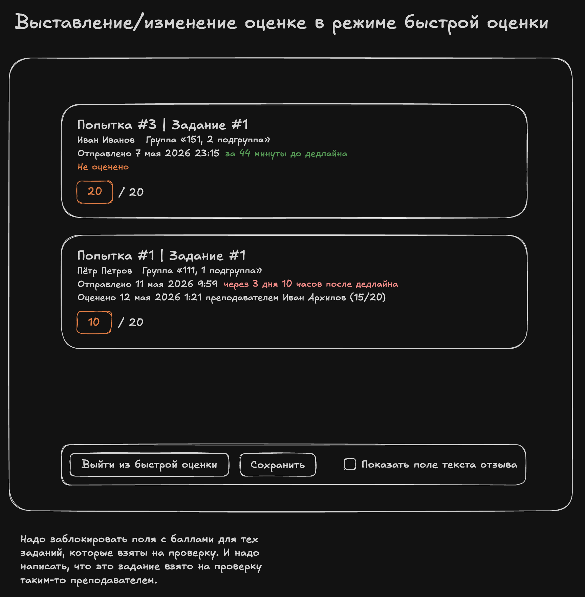
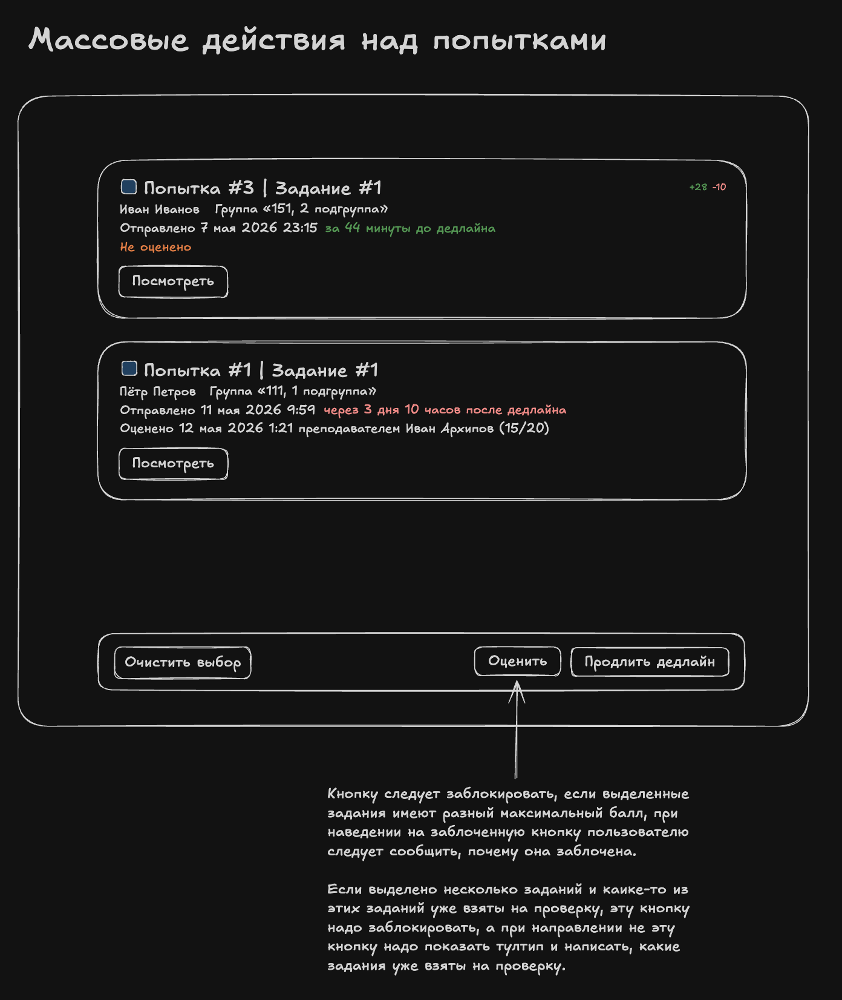

# Attemps list page layout

# Что это?

Страница курса, доступная преподавателю, позволяющая смотреть все попытки всех студентов на этом курсе.

## Левая боковая панель с фильтрами

Кнопка "Применить" должна быть заблокирована, если фильтры никак не изменены.

## Начальное состояние

1. Кнопка "оценить" открывает страницу оценки попытки из issue mm-25.
2. Сверху справа показывается diff-статистика, сколько строк было добавлено и удалено.

## Режим быстрой оценки

1. Если у отзыва было сообщение и не стоит галочка "показать поле текста отзыва", то сообщение прежнее отзыва стирается.
2. Галочка "показать поле текста отзыва" позволяет в режиме быстрой оценки написать/отредактировать текст отзыва для каждой попытки. При нажатии этой галочки либо показывается, либо скрывается дополнительное текстовое поле. Дизайн этого текстового поля описано/будет описано в issue mm-25. Если не описано, то пусть эта галочка пока ничего не делает, тогда надо будет сделать отдельное issue на реализацию этой галочки.

Надо заблокировать поля с баллами для тех заданий, которые взяты на проверку. И надо написать, что это задание взято на проверку таким-то преподавателем.

## Массовые действия над попытками

Кнопку "оценить" следует заблокировать, если выделенные задания имеют разный максимальный балл, при наведении на заблоченную кнопку пользователю следует сообщить, почему она заблочена. Если выделено несколько заданий и каике-то из этих заданий уже взяты на проверку, эту кнопку надо заблокировать, а при направлении не эту кнопку надо показать тултип и написать, какие задания уже взяты на проверку.

# Как это реализовать?

1. Состояния фильтров следует хранить в query-параметрах URLа.
2. Пока что обращений в реальный backend делать не надо, надо сделать моковый API на фронтенде.
