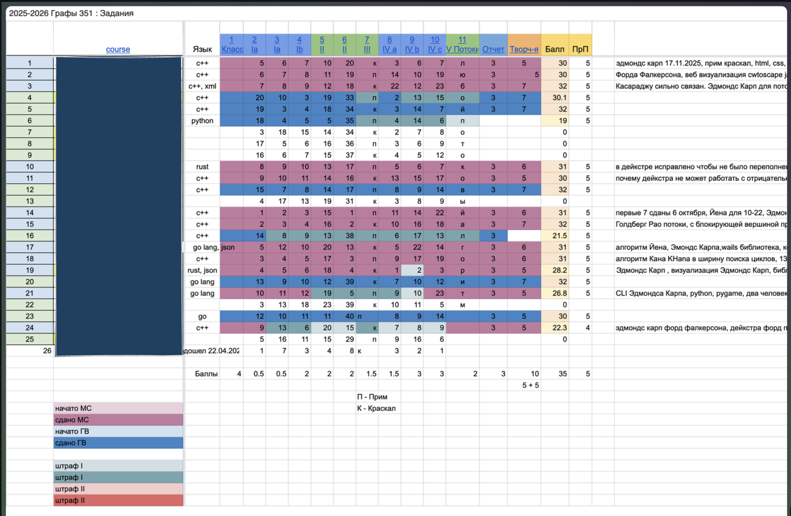

# Таблица оценок курса

Многие преподаватели заводят для своих курсов гугл-таблицы, в которых записывают баллы. Такое представление помогает оценить, сколько студентов близки к закрытию курса и сколько далеки от него. Можно было бы сделать такое представление в MergeMinds.

По нажатию на ячейку можно было бы также открывать окошко для быстрого оценивания последней попытки студента или для правки уже написанного отзыва. В этом окошке должен быть WYSIWYG-редактор и поле для оценки (подробнее о компонентах, которые могли бы пригодиться такому редактору, — в mm-25).
